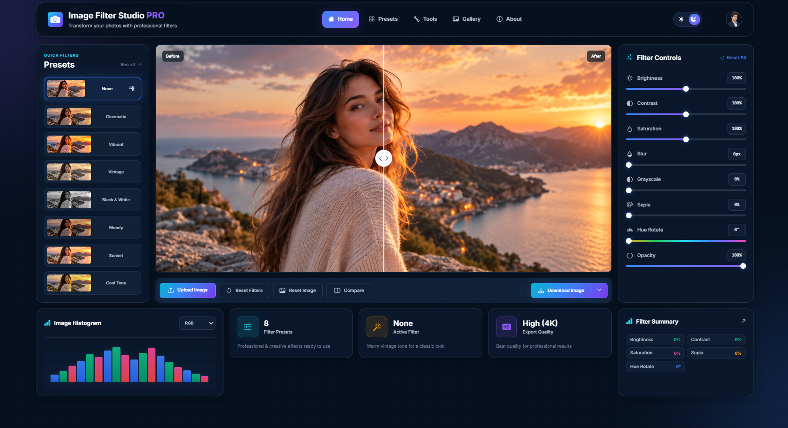

# 🎨 Image Filter Studio PRO

A modern image editing application built with **HTML, CSS and Vanilla JavaScript**.

Image Filter Studio PRO allows users to upload images, apply real-time CSS filters, use predefined presets, compare the original and edited image, and export the final result.

---

## 🚀 Live Demo

https://johnyisbackk.github.io/js-image-filter-studio/

---

## 🖼️ Preview

[](https://johnyisbackk.github.io/js-image-filter-studio/)

---

## ✨ Features

- Upload custom images
- Real-time image filtering
- Brightness control
- Contrast control
- Saturation control
- Blur control
- Grayscale control
- Sepia control
- Hue rotation
- Opacity control
- Predefined image presets
- Custom filter mode
- Before / After image comparison
- Draggable comparison slider
- Reset filters
- Reset image
- Download filtered image
- Image histogram visualization
- RGB / Red / Green / Blue histogram modes
- Filter statistics
- Dynamic filter summary
- Dark / Light theme
- Theme saved in `localStorage`
- Responsive design
- Modern dashboard UI

---

## 🎛️ Available Presets

The application includes multiple predefined filter presets:

- None
- Cinematic
- Vibrant
- Vintage
- Black & White
- Moody
- Sunset
- Cool Tone

Users can also manually modify individual filters, which automatically switches the active filter to **Custom**.

---

## 🖼️ Image Filters

The following filters can be controlled independently:

| Filter     | Range      |
| ---------- | ---------- |
| Brightness | 0% – 200%  |
| Contrast   | 0% – 200%  |
| Saturation | 0% – 200%  |
| Blur       | 0px – 20px |
| Grayscale  | 0% – 100%  |
| Sepia      | 0% – 100%  |
| Hue Rotate | 0° – 360°  |
| Opacity    | 0% – 100%  |

Filters are applied dynamically using the CSS `filter` property.

---

## 🔀 Before / After Comparison

Image Filter Studio PRO includes an interactive image comparison system.

The original image is displayed as the background of the preview area while the filtered version is displayed above it.

The comparison position is controlled dynamically using:

```css
clip-path: inset();
```

Users can drag the comparison handle horizontally to reveal the original and filtered versions of the image.

---

## 📊 Image Histogram

The project also includes a visual image histogram.

Available histogram modes:

- RGB
- Red
- Green
- Blue

The histogram is designed as a lightweight visual component without external chart libraries.

---

## 📈 Filter Statistics

The dashboard displays useful information about the current editing session:

- Number of available presets
- Currently active filter
- Export quality

The **Active Filter** automatically changes when a preset is selected or when filters are manually adjusted.

---

## 📋 Filter Summary

The application displays a live summary of selected filter values including:

- Brightness
- Contrast
- Saturation
- Sepia
- Hue Rotate

Values are automatically updated whenever the user changes a filter or selects a preset.

---

## 📥 Image Export

Edited images can be exported directly from the browser.

The application creates a temporary HTML `<canvas>`, applies the selected filters and draws the image onto the canvas.

The result is then converted into a PNG file and downloaded to the user's device.

---

## 🌓 Dark / Light Mode

The project supports both dark and light themes.

The selected theme is stored using:

```js
localStorage;
```

This means the preferred theme remains active after refreshing or reopening the application.

---

## 🧠 JavaScript Concepts Used

This project was built to practice and strengthen core JavaScript concepts including:

- DOM selection
- Event listeners
- Functions
- Application state
- Conditional statements
- Template literals
- Arrays
- `forEach()`
- Objects
- Dataset attributes
- File input handling
- `URL.createObjectURL()`
- Dynamic styles
- CSS custom properties
- `style.setProperty()`
- `getBoundingClientRect()`
- Pointer events
- Mathematical value conversion
- `Math.min()`
- `Math.max()`
- Canvas API
- Image exporting
- Local Storage

---

## 🛠️ Technologies

- HTML5
- CSS3
- Vanilla JavaScript
- Bootstrap Icons
- Google Fonts
- Canvas API
- Local Storage

No frontend frameworks were used.

---

## 📁 Project Structure

```text
js-image-filter-studio-pro/
│
├── images/
│   └── main-image.jpg
│   └── avatar-image.png
│   └── preview.png
│
│
├── index.html
├── style.css
├── script.js
├── README.md
└── LICENSE
```

---

## 🎯 Project Purpose

The main goal of this project was to strengthen practical Vanilla JavaScript skills through a visual and interactive application.

Instead of focusing on complex data management or large application architecture, the project focuses on clear relationships between:

```text
User Input
    ↓
JavaScript State
    ↓
DOM Update
    ↓
CSS Filter
    ↓
Visual Result
```

This makes the project useful for practicing real-time UI interaction and understanding how JavaScript communicates with the DOM and CSS.

---

## 💡 What I Practiced

While building this project I practiced:

- Reading values from range inputs
- Synchronizing UI values with JavaScript state
- Dynamically applying CSS filters
- Calculating slider progress percentages
- Working with CSS custom properties from JavaScript
- Creating reusable filter presets
- Uploading local images
- Creating temporary object URLs
- Building an interactive Before / After comparison
- Working with cursor position and element dimensions
- Restricting values between minimum and maximum ranges
- Exporting filtered images using Canvas
- Saving theme preferences with Local Storage

---

## 📱 Responsive Design

Image Filter Studio PRO is designed to work across different screen sizes including:

- Desktop
- Laptop
- Tablet
- Mobile

The dashboard layout automatically reorganizes depending on the available screen width.

---

## 🔮 Possible Future Improvements

Possible future additions could include:

- Real pixel-based histogram analysis
- Additional image presets
- Custom preset saving
- Crop tool
- Rotate tool
- Image resizing
- Exposure controls
- Sharpening
- Multiple export formats
- Drag & drop image upload

---

## 👨‍💻 Author

**Samuel Jahn**

Frontend Developer

Portfolio:  
https://samueljahn.sk

GitHub:  
https://github.com/JohnyIsBackk

---

## 📄 License

This project is licensed under the **MIT License**.

See the `LICENSE` file for more information.

---

⭐ If you like the project, feel free to give the repository a star.
